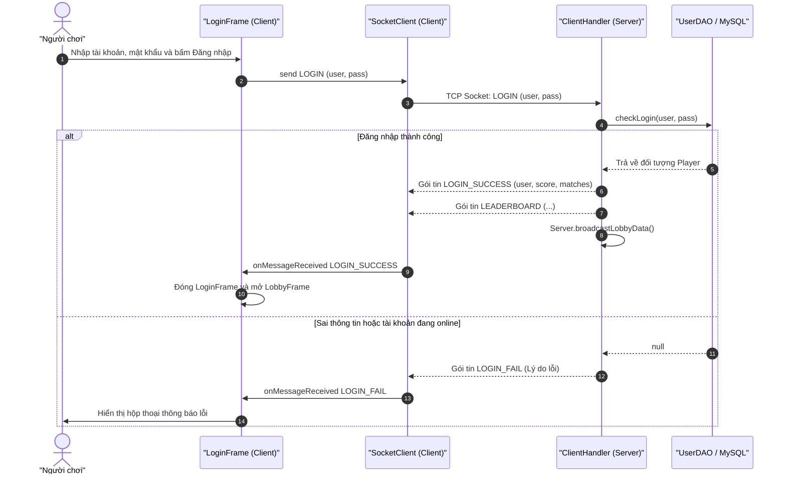
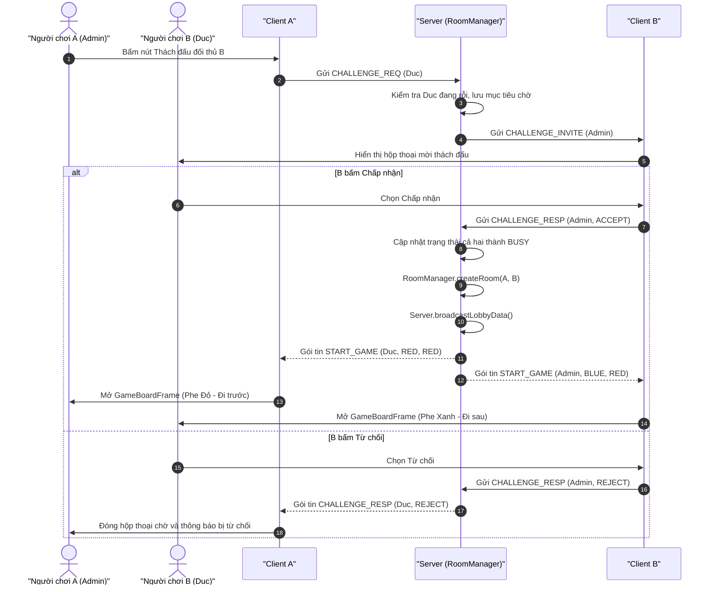
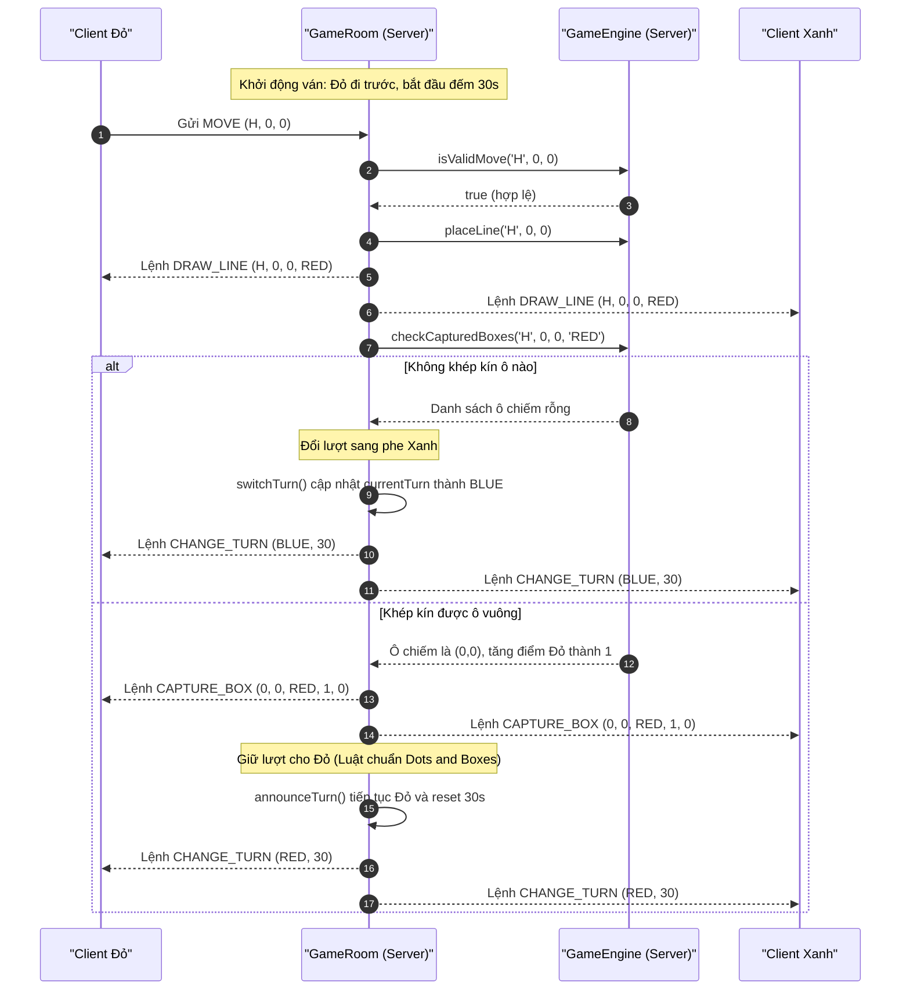
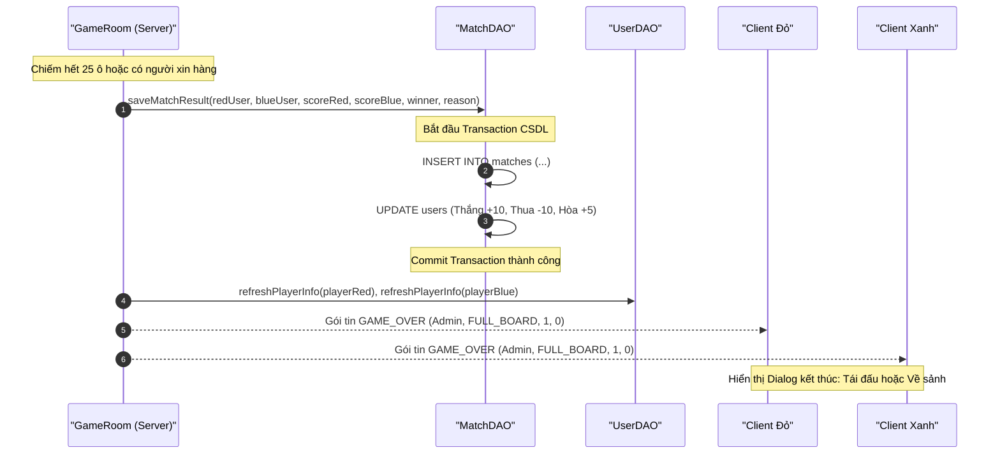

# ĐẶC TẢ CHỨC NĂNG VÀ KIẾN TRÚC HỆ THỐNG
# DỰ ÁN: GAME NỐI ĐIỂM ĐỐI KHÁNG ONLINE (DOTS & BOXES)

---

## 1. TỔNG QUAN DỰ ÁN (PROJECT OVERVIEW)

- **Tên đề tài:** Game Nối Điểm Đối Kháng Trực Tuyến (Dots & Boxes Multiplayer Online).
- **Mục tiêu:** Xây dựng hệ thống trò chơi đối kháng 2 người chơi thời gian thực (Real-time 1vs1) dựa trên kiến trúc **Client - Server** qua mạng TCP/IP.
- **Công nghệ cốt lõi:**
  - **Ngôn ngữ:** Java (JDK 8+).
  - **Mạng (Networking):** Java Socket TCP (`ServerSocket`, `Socket`), xử lý đa luồng (Multi-threading).
  - **Giao diện (Client UI):** Java Swing, tùy biến đồ họa vector `Graphics2D` (hỗ trợ hiển thị Emoji màu, animation và hover hiệu ứng).
  - **Cơ sở dữ liệu (Database):** MySQL, kết nối qua `JDBC Driver` với cơ chế quản lý Transaction an toàn (`commit`/`rollback`).
  - **Giao thức ứng dụng (Application Protocol):** Giao thức hướng dòng văn bản (Text-based stream) định dạng UTF-8, phân tách trường bằng ký tự `;` (`DELIMITER`) và phân tách danh sách bằng `|` (`LIST_DELIMITER`).

---

## 2. CẤU TRÚC THƯ MỤC VÀ PHÂN RÃ MÃ NGUỒN (ARCHITECTURE & PACKAGES)

Toàn bộ mã nguồn nằm trong thư mục `src/`, được tổ chức chặt chẽ theo các phân tầng chức năng:

```
D:\BTL_LTM\src
├── common/                     # Định nghĩa dùng chung giữa Client và Server
│   ├── Protocol.java           # Bộ hằng số danh mục lệnh và giao thức ứng dụng
│   └── PlayerStatus.java       # Enum trạng thái người chơi: FREE (Rỗi), BUSY (Bận)
│
├── entity/                     # Các lớp thực thể dữ liệu (Data Models)
│   ├── Player.java             # Thực thể người chơi (tài khoản, điểm, số trận, trạng thái)
│   └── Match.java              # Thực thể bản ghi kết quả ván đấu
│
├── database/                   # Tầng tương tác Cơ sở dữ liệu (Data Access Layer)
│   ├── DBConnection.java       # Quản lý kết nối MySQL JDBC, nạp cấu hình từ db.properties
│   ├── UserDAO.java            # Truy vấn đăng nhập, đăng ký, BXH, cập nhật thông tin user
│   └── MatchDAO.java           # Lưu lịch sử đấu, nâng cấp schema tự động, tra cứu lịch sử
│
├── server/                     # Tầng lõi máy chủ (Game Server & Engine)
│   ├── Server.java             # Entry point máy chủ, lắng nghe ServerSocket cổng 8888
│   ├── ClientHandler.java      # Luồng xử lý giao tiếp riêng cho từng Client kết nối
│   ├── RoomManager.java        # Quản lý danh sách các phòng thi đấu (activeRooms)
│   ├── GameRoom.java           # Điều phối ván đấu 1vs1, đếm giờ trận & lượt, tái đấu
│   └── GameEngine.java         # Thuật toán bàn cờ 5x5, nhận diện ô khép kín, tính điểm
│
├── client/                     # Tầng máy khách (Client Application & Swing UI)
│   ├── MainClient.java         # Entry point khởi động ứng dụng Client
│   ├── TestClient.java         # Client dạng dòng lệnh (CLI) phục vụ kiểm thử nhanh
│   ├── network/
│   │   ├── SocketClient.java   # Singleton quản lý kết nối TCP, luồng đọc ngầm UTF-8
│   │   └── MessageListener.java# Interface callback nhận gói tin trên luồng Swing EDT
│   └── view/
│       ├── AppUI.java          # Bộ màu sắc, font, hiệu ứng gradient, viền bo góc dùng chung
│       ├── ChatEmoji.java      # Bộ render 10 emoji dạng vector 2D trên lưới 24x24
│       ├── ChatPanel.java      # Panel trò chuyện trong trận đấu (bong bóng chat, emoji picker)
│       ├── LoginFrame.java     # Giao diện Đăng nhập tài khoản
│       ├── RegisterFrame.java  # Giao diện Đăng ký tài khoản
│       ├── LobbyFrame.java     # Giao diện Sảnh chờ: Danh sách Online, BXH, Thách đấu
│       ├── GameBoardFrame.java # Giao diện Bàn cờ thi đấu 5x5 ô (Dumb View), đồng hồ, chat
│       └── MatchHistoryDialog.java # Hộp thoại thống kê lịch sử trận đấu cá nhân
│
└── test/                       # Kiểm thử độc lập từng tầng
    ├── GameEngineTest.java     # Kiểm thử đơn vị thuật toán khép ô của GameEngine
    ├── MockServerTest.java     # Server giả lập phục vụ test độc lập giao diện Client
    └── TestDBConnection.java   # Kiểm tra kết nối MySQL và xuất dữ liệu mẫu
```

---

## 3. QUY ƯỚC GIAO THỨC TRUYỀN THÔNG ĐIỆP (APPLICATION PROTOCOL SPECIFICATION)

### 3.1. Nguyên tắc đóng gói và phân tích dữ liệu
- Dữ liệu được truyền qua kênh TCP dưới dạng dòng văn bản thuần (`String`), mã hóa chuẩn **UTF-8**, kết thúc mỗi gói tin bằng ký tự xuống dòng `\n`.
- Dấu phân tách giữa các trường dữ liệu: `;` (`Protocol.DELIMITER`).
- Dấu phân tách giữa các phần tử trong danh sách: `|` (`Protocol.LIST_DELIMITER`).

### 3.2. Danh mục chi tiết các lệnh theo nhóm chức năng

| Nhóm chức năng | Chiều truyền | Cú pháp gói tin | Ý nghĩa & Mô tả |
| :--- | :---: | :--- | :--- |
| **Xác thực** | C -> S | `LOGIN;<tài_khoản>;<mật_khẩu>` | Gửi yêu cầu đăng nhập |
| | S -> C | `LOGIN_SUCCESS;<tài_khoản>;<điểm>;<số_trận>` | Đăng nhập thành công, trả về điểm & số trận |
| | S -> C | `LOGIN_FAIL;<lý_do>` | Báo lỗi đăng nhập sai hoặc trùng tài khoản đang online |
| | C -> S | `REGISTER;<tài_khoản>;<mật_khẩu>` | Gửi yêu cầu đăng ký mới |
| | S -> C | `REGISTER_SUCCESS` | Đăng ký thành công |
| | S -> C | `REGISTER_FAIL;<lý_do>` | Báo lỗi tài khoản đã tồn tại hoặc lỗi CSDL |
| **Sảnh chờ (Lobby)** | C -> S | `GET_LOBBY` | Yêu cầu làm mới thông tin cá nhân, sảnh và BXH |
| | S -> C | `LOBBY_DATA;<user,score,matches,status\|...>` | Danh sách người chơi online (loại trừ chính mình) |
| | S -> C | `LEADERBOARD;<user,score,matches\|...>` | Top 10 người chơi điểm cao nhất toàn hệ thống |
| **Thách đấu** | C -> S | `CHALLENGE_REQ;<tên_đối_thủ>` | Gửi lời mời thách đấu 1vs1 tới đối thủ |
| | S -> C | `CHALLENGE_INVITE;<người_mời>` | Bắn popup hỏi người được mời có chấp nhận không |
| | C -> S / S -> C | `CHALLENGE_RESP;<tên>;ACCEPT\|REJECT` | Phản hồi lời mời (Chấp nhận hoặc Từ chối) |
| | C -> S / S -> C | `CHALLENGE_CANCEL;<tên_đối_thủ>` | Hủy lời mời thách đấu trước khi đối phương phản hồi |
| **Thi đấu (Arena)** | S -> C | `START_GAME;<đối_thủ>;<màu_mình>;<màu_lượt_đi>` | Khởi động ván đấu (`RED` hoặc `BLUE`) |
| | S -> C | `MATCH_INFO;<số_thứ_tự_trận>;<thắng_đỏ>;<thắng_xanh>;<giây_còn_lại>` | Báo thông tin chuỗi trận & đồng hồ tổng 240s |
| | C -> S | `MOVE;<H\|V>;<hàng>;<cột>` | Đánh một cạnh ngang (`H`) hoặc dọc (`V`) |
| | S -> C | `DRAW_LINE;<H\|V>;<hàng>;<cột>;<màu>` | Lệnh cho 2 client vẽ cạnh vừa đánh lên bàn cờ |
| | S -> C | `CAPTURE_BOX;<hàng>;<cột>;<màu>;<điểm_đỏ>;<điểm_xanh>` | Tô màu ô vuông bị khép kín và cập nhật điểm số |
| | S -> C | `CHANGE_TURN;<màu_lượt_tiếp>;<thời_gian>` | Chuyển lượt đi và reset đồng hồ 30s |
| | S -> C | `TURN_TIMEOUT;<màu_hết_giờ>;<số_lần_liên_tiếp>` | Cảnh báo hết giờ lượt (quá 3 lần liên tiếp xử thua) |
| | C -> S | `SURRENDER` / `LEAVE_ROOM` | Xin hàng / rời phòng đấu quay về sảnh |
| | S -> C | `GAME_OVER;<người_thắng>;<lý_do>;<thắng_đỏ>;<thắng_xanh>` | Kết thúc trận đấu (`DRAW` nếu hòa; lý do: `FULL_BOARD`, `SURRENDER`, `TIMEOUT`, `TIME_UP`) |
| **Tái đấu & Thoát** | C -> S | `REMATCH_REQ` | Người chơi gửi yêu cầu đấu tiếp ván nữa |
| | S -> C | `REMATCH_INVITE` | Báo cho đối thủ biết người kia muốn tái đấu |
| | C -> S / S -> C | `REMATCH_RESP;ACCEPT\|REJECT` | Chấp nhận (reset ván mới) hoặc từ chối (giải phóng phòng) |
| **Trò chuyện (Chat)**| C -> S | `CHAT;<nội_dung>` | Gửi tin nhắn hoặc biểu tượng cảm xúc (tối đa 200 ký tự) |
| | S -> C | `CHAT_MSG;<người_gửi>;<nội_dung>` | Chuyển tiếp tin nhắn tới cả 2 người chơi trong phòng |
| **Lịch sử đấu** | C -> S | `GET_HISTORY;[tên_người_chơi]` | Tra cứu lịch sử (để trống là xem của chính mình) |
| | S -> C | `HISTORY;<tên>;<tổng,thắng,thua,hòa>;<danh_sách_trận>` | Dữ liệu thống kê và danh sách 50 trận gần nhất |
| | S -> C | `HISTORY_FAIL;<lý_do>` | Báo lỗi khi người chơi không tồn tại hoặc lỗi CSDL |

---

## 4. LUỒNG HOẠT ĐỘNG VÀ CƠ CHẾ TRUYỀN DỮ LIỆU (WORKFLOWS & DATA FLOW)

### 4.1. Luồng Xác thực: Đăng nhập & Đăng ký


### 4.2. Luồng Sảnh chờ & Thách đấu (Lobby & Matchmaking)


### 4.3. Luồng Tiến trình Thi đấu & Luật Nối Điểm (Gameplay & Engine Rules)


### 4.4. Cơ chế Đếm giờ & Xử lý Timeout
1. **Bộ đếm giờ toàn trận (`MATCH_TIME_SECONDS = 240s`)**:
   - Sử dụng `ScheduledExecutorService` (`TURN_TIMER`) của Server.
   - Khi hết 4 phút, Server tự động kích hoạt `handleMatchTimeout(seq)`: so sánh tổng số ô chiếm được giữa 2 bên. Nếu bằng điểm, công bố kết quả `DRAW` (Hòa); ngược lại người chiếm nhiều ô hơn giành chiến thắng (`REASON_TIME_UP`).
2. **Bộ đếm giờ mỗi lượt (`TURN_TIME_SECONDS = 30s`)**:
   - Mỗi khi đổi lượt hoặc người chơi ăn ô được giữ lượt, Server lên lịch tác vụ đếm lùi 30 giây kèm biến chuỗi `turnSeq`.
   - Nếu hết 30s mà người chơi không gửi nước đi hợp lệ:
     - Tăng biến đếm `timeoutsRed` hoặc `timeoutsBlue`.
     - Phát gói tin `TURN_TIMEOUT;màu;số_lần_liên_tiếp` về cho cả 2 máy (Client hiện thông báo Toast cam cảnh báo).
     - Nếu số lần hết giờ liên tiếp đạt ngưỡng `MAX_CONSECUTIVE_TIMEOUTS = 3`: Server lập tức xử thua người chơi đó (`forfeit`) với lý do `REASON_TIMEOUT`.
     - Nếu chưa tới 3 lần: Server tự động đổi lượt sang đối thủ (`switchTurn`).
     - Khi người chơi thực hiện 1 nước đi hợp lệ, bộ đếm vi phạm liên tiếp lập tức được reset về 0.

### 4.5. Cơ chế Trò chuyện (Chat Panel & Vector Emoji)
1. **Bảo toàn dữ liệu:**
   - Client gửi lệnh dạng `CHAT;<nội_dung>`. Nếu nội dung chứa dấu chấm phẩy `;`, Server dùng `message.substring(indexOf(';') + 1)` để không cắt vụn nội dung.
   - Server kiểm soát độ dài tin nhắn (tối đa 200 ký tự) và kiểm tra `Character.isHighSurrogate()` để không cắt rời mã Unicode của Emoji 2-byte.
2. **Khắc phục giới hạn đồ họa Java Swing trên Windows:**
   - Java Swing trên nền Windows mặc định không render được Emoji Unicode màu (chỉ hiện ô vuông hoặc nét đen trắng).
   - Module `ChatEmoji` tự động phát hiện emoji và vẽ lại hoàn toàn bằng vector đồ họa 2D (`Graphics2D`, `Path2D`, `Arc2D`, `Ellipse2D`) trên lưới toạ độ chuẩn 24x24 pixel.
   - Nếu tin nhắn chỉ gồm từ 1 đến 3 emoji (`isOnlyEmoji`), hệ thống tự động phóng to emoji lên kích thước 34px (Big Emoji Mode) tạo trải nghiệm trò chuyện sống động.

### 4.6. Luồng Kết thúc ván, Lưu kết quả CSDL & Tái đấu


---

## 5. MÔ HÌNH ĐA LUỒNG VÀ ĐỒNG BỘ DỮ LIỆU (CONCURRENCY & THREADING MODEL)

### 5.1. Phía Server
- **Mô hình Thread-per-Client:**
  - Luồng chính (`main`) chạy vòng lặp `serverSocket.accept()` liên tục lắng nghe kết nối mới.
  - Khi có một Client kết nối vật lý thành công, Server sinh ra một đối tượng `ClientHandler` chạy trên Thread độc lập.
- **Đảm bảo Thread-safe:**
  - Danh sách người chơi online được quản lý bằng `ConcurrentHashMap<String, ClientHandler> onlineUsers`.
  - Danh sách phòng thi đấu được lưu trong `ConcurrentHashMap<String, GameRoom> activeRooms`.
  - Các phương thức thay đổi trạng thái ván đấu trong `GameRoom` (`handleMove`, `switchTurn`, `forfeit`, `reset`) đều được bảo vệ bằng từ khóa `synchronized` để chống tranh chấp dữ liệu (Race Condition).
- **Bộ Timer dùng chung:**
  - Khởi tạo duy nhất 1 luồng daemon `ScheduledExecutorService` (`Turn-Timer`) dùng chung cho toàn bộ Server, tối ưu tài nguyên CPU và bộ nhớ thay vì tạo mới luồng ngủ `Thread.sleep` liên tục.
  - Áp dụng kỹ thuật `seq counter` (`turnSeq`, `matchSeq`) để loại bỏ hoàn toàn các tác vụ hẹn giờ chạy trễ (stale timer execution).

### 5.2. Phía Client
- **Triết lý Dumb View:**
  - Các lớp giao diện (`GameBoardFrame`, `LobbyFrame`, `MatchHistoryDialog`) đóng vai trò là "View thuần túy" (Dumb View).
  - Client tuyệt đối không tự tính điểm, không tự quyết định thắng/thua, không tự đổi lượt hay tự vẽ cạnh trước khi có xác nhận từ Server. Mọi thay đổi trên màn hình chỉ được render khi nhận được gói tin chính thức (`DRAW_LINE`, `CAPTURE_BOX`, `CHANGE_TURN`, `GAME_OVER`).
- **An toàn giao diện Swing (Swing EDT Concurrency):**
  - Mọi thao tác I/O mạng chạy ngầm trên luồng daemon riêng biệt `Client-Socket-Listener` trong `SocketClient`.
  - Khi có dữ liệu gửi về từ Server, `SocketClient` tự động chuyển tiếp thông qua `SwingUtilities.invokeLater()` sang **Event Dispatch Thread (EDT)** trước khi gọi `MessageListener.onMessageReceived()`. Điều này loại bỏ hoàn toàn nguy cơ deadlock và lỗi hiển thị giao diện của thư viện Swing.

---

## 6. MÔ HÌNH DỮ LIỆU MYSQL (DATABASE SCHEMA & DESIGN)

Cơ sở dữ liệu gồm 2 bảng quan hệ chặt chẽ:

### 6.1. Bảng `users` (Thông tin người chơi)
| Cột | Kiểu dữ liệu | Ràng buộc | Mô tả |
| :--- | :--- | :--- | :--- |
| `id` | `INT` | `AUTO_INCREMENT, PRIMARY KEY` | Khóa chính |
| `username` | `VARCHAR(50)` | `NOT NULL, UNIQUE` | Tên tài khoản người chơi |
| `password` | `VARCHAR(255)` | `NOT NULL` | Mật khẩu tài khoản |
| `total_score` | `INT` | `DEFAULT 0` | Tổng điểm tích lũy xếp hạng |
| `total_matches`| `INT` | `DEFAULT 0` | Tổng số trận đấu đã tham gia |
| `created_at` | `TIMESTAMP` | `DEFAULT CURRENT_TIMESTAMP` | Thời điểm tạo tài khoản |

### 6.2. Bảng `matches` (Lịch sử các ván đấu)
| Cột | Kiểu dữ liệu | Ràng buộc | Mô tả |
| :--- | :--- | :--- | :--- |
| `match_id` | `INT` | `AUTO_INCREMENT, PRIMARY KEY` | Khóa chính bản ghi ván đấu |
| `player_red_id` | `INT` | `NOT NULL, FK -> users(id)` | Khóa ngoại người chơi phe Đỏ |
| `player_blue_id`| `INT` | `NOT NULL, FK -> users(id)` | Khóa ngoại người chơi phe Xanh |
| `red_score` | `INT` | `DEFAULT 0` | Số ô người chơi Đỏ chiếm được |
| `blue_score` | `INT` | `DEFAULT 0` | Số ô người chơi Xanh chiếm được |
| `winner_id` | `INT` | `NULL, FK -> users(id)` | Người thắng (`NULL` nếu ván đấu hòa) |
| `end_reason` | `VARCHAR(20)`| `NULL` | Lý do kết thúc: `FULL_BOARD`, `SURRENDER`, `TIMEOUT`, `TIME_UP` |
| `finished_at` | `TIMESTAMP` | `DEFAULT CURRENT_TIMESTAMP` | Thời điểm kết thúc trận đấu |

### 6.3. Tính năng tự động thích ứng CSDL (`ensureSchema`)
Để tương thích với các máy chạy đồ án sử dụng file SQL cũ, phương thức `MatchDAO.ensureSchema()` được Server tự động gọi ngay khi khởi động. Hàm này truy vấn bảng `information_schema.COLUMNS` để kiểm tra sự tồn tại của cột `winner_id` và `end_reason`. Nếu chưa có, Server sẽ tự động thực thi lệnh `ALTER TABLE` bổ sung cột và khóa ngoại mà không yêu cầu người dùng phải gỡ hay tạo lại CSDL thủ công.

---

## 7. TỔNG KẾT VÀ ĐÁNH GIÁ (CONCLUSION)

1. **Tính hoàn thiện:** Hệ thống đã đáp ứng trọn vẹn mọi yêu cầu của đề tài Lập trình mạng: từ xác thực tài khoản, sảnh chờ đồng bộ thời gian thực, thách đấu 1vs1, luật chơi chuẩn Dots & Boxes, cơ chế timeout đa cấp độ, trò chuyện hỗ trợ emoji vector đến lưu trữ CSDL MySQL và xếp hạng cao thủ.
2. **Tính tin cậy & ổn định:**
   - Quản lý đồng bộ chặt chẽ bằng Transaction và đa luồng an toàn.
   - Chặn các tình huống bất thường: đăng nhập trùng lặp, gửi lời mời khi đối thủ đang bận, mất kết nối đột ngột (tự động xử thua và giải phóng tài nguyên).
   - Mô hình Dumb View giúp giữ nguyên tính toàn vẹn của trạng thái trò chơi tại Server, chống gian lận từ phía Client.
3. **Trải nghiệm người dùng (UX/UI):**
   - Thiết kế giao diện hiện đại theo chuẩn màu Slate/Indigo bo góc thanh lịch.
   - Tối ưu hóa phản hồi trực quan với hiệu ứng hover cạnh, hoạt ảnh đồng hồ đếm ngược, avatar nhận diện màu và hộp thoại lịch sử đấu thống kê trực quan.

